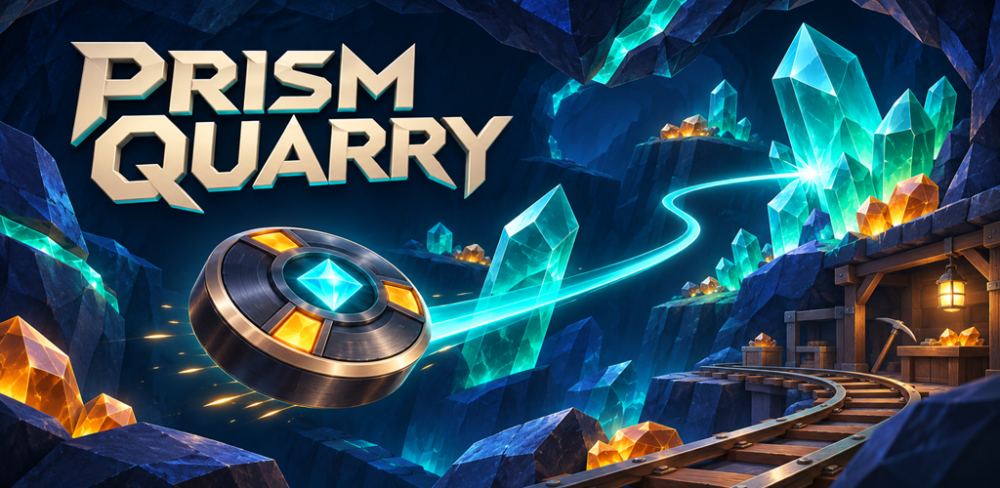

# Prism Quarry

**Find the perfect angle.** A portrait, one-finger crystal ricochet game in Godot 4.5.1 Compatibility. Drag to aim a glowing drill puck, release through crystal seams, bank the haul and build a small underground workshop.



30 authored chambers span Amber Hollow, Azure Grotto and Violet Vault. The game includes a seeded daily chamber, Endless Quarry, miner XP, drill/rig progression, cosmetics, daily goals, a seven-day login cycle, local achievements and records. Branding above is promotional illustration, not a gameplay screenshot. Exact implementation acceptance and untested checks belong in [the evidence record](docs/ACCEPTANCE.md).

- [Styled review](review/index.html) and [capture provenance](marketing/screenshots/provenance.json)
- [Store and release preparation](docs/STORE_AND_RELEASE.md)
- [Android service setup](docs/PLATFORM_SETUP.md)
- [Shared achievement/leaderboard catalog](game/catalog.json), [achievement ZIP](marketing/play-games-achievements/prism-quarry-achievements-google-play.zip), and [schema/validation notes](docs/ACHIEVEMENTS_IMPORT.md)
- [Artwork and audio provenance](docs/ART_AUDIO.md)

## Run and build

Open `project.godot` in **Godot 4.5.1** using Compatibility. Target distributions are Android and single-threaded Web; there is no Windows distribution. Drag to aim and release to shoot; use the visible pause/recall controls. Tutorial chambers introduce the loop through play.

```sh
godot --headless --editor --path . --import
mkdir -p build/site/play
godot --headless --path . --export-release Web build/site/play/index.html
python tools/assemble_site.py build/site
python -m http.server 8768 --bind 127.0.0.1 --directory build/site
```

Open `http://127.0.0.1:8768/` for the playable wrapper or `/review/` for the review. Open review/index.html directly from disk to see genuine static fallback screenshots. Serving it over HTTP loads the provenance manifests and enables the complete galleries and profile controls. WebGL 2 is required; a browser without it has not passed runtime testing. Browser saves are local, and clearing site data removes progress. Web does not simulate native ad rewards.

After matching templates, Java 17 and the Android SDK are available, the native presets are `Android` (debug AAB) and `Android Test APK`. See the platform setup for prerequisites and plugin configuration.

```sh
godot --headless --path . --install-android-build-template
mkdir -p build/android
godot --headless --path . --export-debug Android build/android/prism-quarry-debug.aab
godot --headless --path . --export-debug "Android Test APK" build/android/prism-quarry-test.apk
```

Use fresh isolated user-data directories for tests; never point a test at the owner's saved game. On Linux, set `XDG_DATA_HOME` and `PRISM_TEST_ROOT` to a fresh directory per suite. On Windows set process-local `APPDATA`, `LOCALAPPDATA` and `PRISM_TEST_ROOT` before launching the test process.

```sh
godot --headless --path . --script tests/game_model_test.gd
godot --headless --path . --script tests/game_ui_test.gd -- --qa-profile=user://qa-ui-unique-run.json
python tools/run_touch_regression.py --godot /absolute/path/to/godot
python platform/tests/run_tests.py --godot /absolute/path/to/godot
python platform/tests/validate_platform.py
python tools/validate_store.py
python tools/build_achievement_import.py --self-test
python tools/build_achievement_import.py --verify marketing/play-games-achievements/prism-quarry-achievements-google-play.zip
```

## Verification and publication

GitHub Actions validates and exports Web on standard hosted runners. Manual dispatch can also request Android test packages. Artifacts use bounded retention. The site assembler's `--require-clean --expected-sha <commit>` mode refuses a dirty or mismatched checkout after export; `build.json` binds source and Web files. See acceptance evidence for actual successful runs instead of assuming the workflow has passed.

Pages is a separately gated, manual workflow. Its presence does not activate hosting or authorize publication. The review contains no claimed live URL until deployment is independently verified.

Android advertising uses test configuration; production Play Games mappings are disabled. Production service IDs, consent/privacy declarations, support contact, signing and Google Play release remain owner work. Store/privacy/support text is explicitly a draft. Static achievement ZIP validation is not Console acceptance.

**Sunken Geodes**, flooded chambers with refracting currents, is a future DLC concept only. No release date, price or purchase product is configured.

Original project code: Apache 2.0. Third-party assets and native dependencies keep their own licenses. See [NOTICE](NOTICE), [LICENSES](LICENSES/) and the art/audio provenance for exact attribution.
